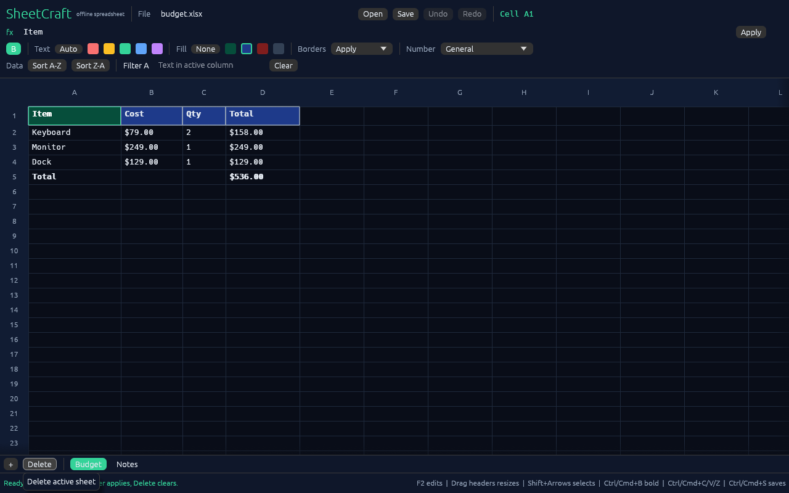

<p align="center">
  
</p>

# SheetCraft

[](https://github.com/dsk-dev-ai/sheetcraft/releases/latest)

An open-source spreadsheet editor written from scratch in pure Rust.

**Fast. Offline. Private. One binary. No account, no subscription, no telemetry.**

SheetCraft aims to be the spreadsheet people reach for when they want Excel-class
editing without a cloud account or a 500 MB office suite: native performance,
instant startup, full local ownership of every file.

## Why this exists

- Spreadsheet work is still dominated by cloud-first tools that require accounts
  and upload private financial data.
- Existing desktop suites are large, slow to start, and carry decades of legacy.
- The "clean-room, pure Rust" approach already proved it can win attention for
  photo, PDF, video, and word editors. A spreadsheet is the largest remaining gap.

## Status

Early core engine. The repository currently ships:

- A cell model with typed values (number, text, boolean, error)
- A formula parser and evaluator with arithmetic, cell refs, ranges, and
  `SUM` / `AVERAGE` / `MIN` / `MAX`
- Cycle detection for circular references
- CSV import and export with quoted fields, commas, and embedded newlines
- XLSX import of all worksheets and their names, preserving supported formulas
- XLSX export of multiple sheets with formulas, numbers, booleans, text, and
  cell formatting
- A native desktop app with a virtualized grid, formula bar with reference
  highlighting, range selection, keyboard navigation, copy and paste, and undo
  and redo
- Number formats, bold text, text colors, cell fills, and cell borders in the
  desktop app, exported to XLSX
- Resizable columns and rows in the desktop app, exported to XLSX
- Multiple sheets with tabs to add, switch, and delete sheets
- Row sorting and text filtering in the desktop app; filters hide rows without
  changing saved data
- A small CLI for evaluating formulas, previewing workbooks, and converting
  CSV to XLSX
- Unit tests for parsing, evaluation, and file round trips

Charts and freeze panes are next on the roadmap. XLSX import preserves values,
sheet names, and supported formulas; visual formatting is applied in the app and
included when exporting to XLSX.

## Download

Prebuilt CLI and desktop binaries for Linux, macOS, and Windows are on the
[releases page](https://github.com/dsk-dev-ai/sheetcraft/releases/latest).
Unpack the archive and run `sheetcraft` for the CLI or `sheetcraft-gui` for the
desktop app.

## Quick start

```bash
cargo run --features gui --bin sheetcraft-gui

cargo run -- demo
cargo run -- eval '=SUM(A1:A3) * 2'
cargo run -- csv examples/budget.csv
cargo run -- xlsx path/to/workbook.xlsx
cargo run -- convert examples/budget.csv /tmp/budget.xlsx
cargo test
```

The GUI opens with a small sample sheet. Type a path in the file field and use
Open or Save to load and store CSV or XLSX workbooks. Start typing to edit a
cell, or use double-click or F2 to edit the current value. Arrow keys move the
selection, Shift+arrows or Shift+click selects a range, Enter applies and moves
down, Escape cancels, Delete clears the selection, and Ctrl/Cmd+C, V, Z, and
Shift+Z copy, paste, undo, and redo. The formatting bar applies bold, text and
fill colors, borders, and number formats to the current selection; Ctrl/Cmd+B
toggles bold. Drag a column or row header edge to resize it. Use the Data bar
to sort by the active column or filter rows by text; filters are view-only. Use
the sheet tabs above the status bar to switch sheets, or add and delete sheets
with the + and Delete buttons.



## Roadmap

See [ROADMAP.md](ROADMAP.md).

- v0.1 Core engine and CLI (done)
- v0.2 CSV and XLSX import/export (done)
- v0.3 Native GUI with a virtualized grid (done)
- v0.4 Formatting, charts, and multi-sheet workbooks
- v1.0 Stable release and launch

## Design principles

1. **Local-first.** Files stay on disk. No network calls in the default build.
2. **Instant.** Release-build cold start under 300 ms, even on large workbooks.
3. **Correct.** Formula results are tested against reference spreadsheets.
4. **Small.** A single self-contained binary, no runtime install.
5. **Open.** MIT licensed, no open-core bait-and-switch.


## License

MIT
