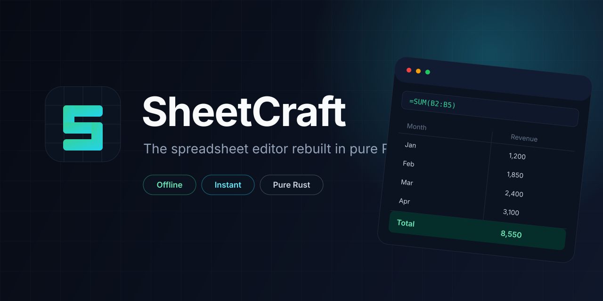

<p align="center">
  
</p>

# SheetCraft

An open-source spreadsheet editor written from scratch in pure Rust.

**Fast. Offline. Private. One binary. No account, no subscription, no telemetry.**

SheetCraft aims to be the spreadsheet people reach for when they want Excel-class
editing without a cloud account or a 500 MB office suite: native performance,
instant startup, full local ownership of every file.

## Why this exists

- Spreadsheet work is still dominated by cloud-first tools that require accounts
  and upload private financial data.
- Existing desktop suites are large, slow to start, and carry decades of legacy.
- The "clean-room, pure Rust" approach already proved it can win attention for
  photo, PDF, video, and word editors. A spreadsheet is the largest remaining gap.

## Status

Early core engine. The repository currently ships:

- A cell model with typed values (number, text, boolean, error)
- A formula parser and evaluator with arithmetic, cell refs, ranges, and
  `SUM` / `AVERAGE` / `MIN` / `MAX`
- Cycle detection for circular references
- CSV import and export with quoted fields, commas, and embedded newlines
- A small CLI for evaluating formulas, previewing CSV files, and running a demo
- Unit tests for parsing, evaluation, and CSV round trips

XLSX support, the GUI, and formatting are next on the roadmap.

## Quick start

```bash
cargo run -- demo
cargo run -- eval '=SUM(A1:A3) * 2'
cargo run -- csv examples/budget.csv
cargo test
```

## Roadmap

See [ROADMAP.md](ROADMAP.md).

- v0.1 Core engine and CLI (done)
- v0.2 CSV import/export, XLSX next (in progress)
- v0.3 Native GUI with a virtualized grid
- v0.4 Formatting, charts, and multi-sheet workbooks
- v1.0 Stable release and launch

## Design principles

1. **Local-first.** Files stay on disk. No network calls in the default build.
2. **Instant.** Cold start under 100 ms, even on large workbooks.
3. **Correct.** Formula results are tested against reference spreadsheets.
4. **Small.** A single self-contained binary, no runtime install.
5. **Open.** MIT licensed, no open-core bait-and-switch.


## License

MIT
